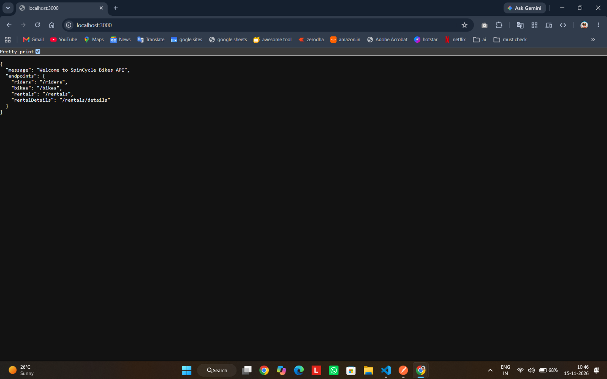
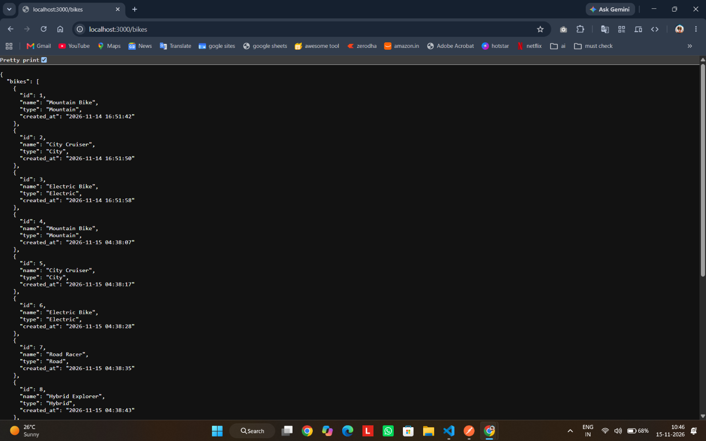
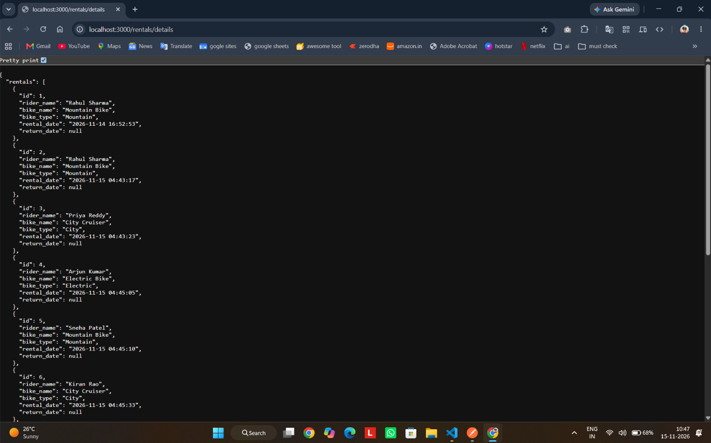
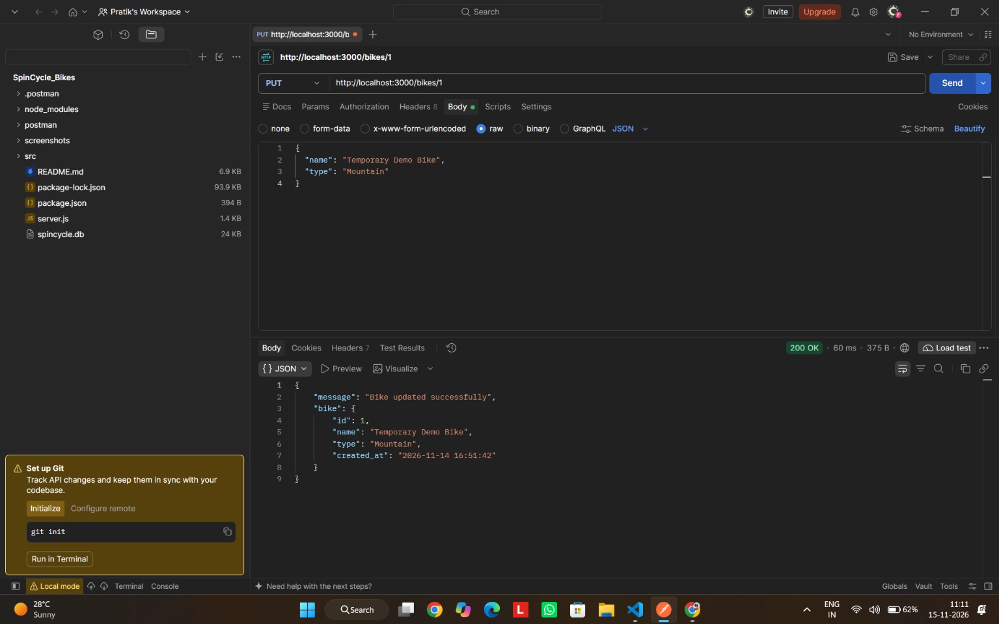
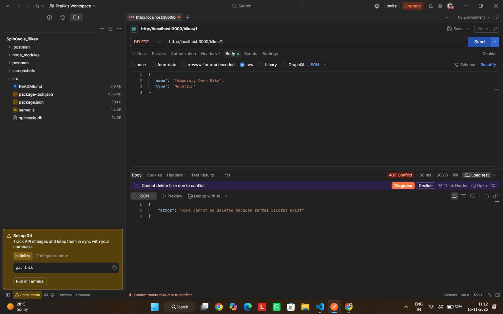

# SpinCycle Bikes
### Backend Development Fundamentals — Group Assignment

**Assignment ID:** ST-AIDE2A-G03  
**Theme:** Campus Bike Share  
**Technology:** Node.js, Express.js, SQLite  
**API Testing:** Postman

---

## 1. Project Overview

SpinCycle Bikes is a backend application developed to manage a campus bicycle-sharing system.

The project replaces the traditional paper-based notebook used to track campus bike rentals. Instead of manually recording rider details, bike information, and rental history, the application stores and manages this information in an SQLite database.

The system provides REST APIs to manage riders, bikes, and rentals. It also includes search functionality, input validation, database relationships, and rental history management.

The main objective of this project is to demonstrate practical backend development using Node.js, Express.js, SQLite, and Postman.

## 2. Problem Statement

Traditional campus bike-sharing systems may depend on physical registers or notebooks to maintain rental information.

This approach can make it difficult to:
- Maintain rider and bike information.
- Search for a particular bike.
- Track rental history.
- Identify which rider rented a particular bike.
- Update or retrieve records efficiently.

SpinCycle Bikes provides a centralized digital backend system to manage these operations through REST APIs.

## 3. Project Objectives

The main objectives are:

1. Develop a backend application using Node.js and Express.js.
2. Create a relational SQLite database.
3. Implement CRUD operations for bikes.
4. Manage rider information.
5. Create and retrieve rental records.
6. Implement SQL JOIN operations to display combined rental details.
7. Validate incoming data.
8. Implement the assigned Smart Search feature.
9. Test API endpoints using Postman.
10. Document the application and its functionality.

## 4. Technology Stack

| Technology | Purpose |
|---|---|
| Node.js | JavaScript runtime environment |
| Express.js | Backend framework |
| SQLite | Relational database |
| SQL | Database queries and relationships |
| JavaScript | Application logic |
| Postman | API testing |
| npm | Package management |
| Git / GitHub | Version control and project sharing |

## 5. Main Features

### 5.1 Rider Management

The application supports:
- Registering new riders.
- Retrieving all riders.
- Retrieving an individual rider by ID.
- Validating rider names and email addresses.
- Preventing duplicate email registrations.

### 5.2 Bike Management

The bike module provides complete CRUD functionality:

- Create: Add a new bike.
- Read: Retrieve all bikes or one bike.
- Update: Modify existing bike details.
- Delete: Delete a bike when rental records do not reference it.

Each bike contains a unique ID, name, type, and creation timestamp.

### 5.3 Rental Management

The rental module supports:
- Creating rental records.
- Retrieving all rentals.
- Retrieving individual rental records.
- Displaying rental details with rider and bike names.
- Marking rentals as returned.

### 5.4 Input Validation

Validation prevents invalid data from being stored in the database.

Examples include:
- Bike name cannot be empty.
- Bike type cannot be empty.
- Rider name cannot be empty.
- Email must be valid.
- Duplicate email addresses are not accepted.
- Rental requests must reference existing riders and bikes.

### 5.5 Error Handling

The application uses HTTP status codes to communicate API results.

| Status Code | Meaning |
|---|---|
| 200 | Request completed successfully |
| 201 | New resource created |
| 400 | Invalid or missing input |
| 404 | Requested record or route not found |
| 409 | Conflict with existing database records |
| 500 | Unexpected server or database error |

## 6. Special Assignment Requirement — Smart Search

**Assignment ID: ST-AIDE2A-G03**

The special twist assigned to this group is **Smart Search**.

This feature allows users to search for bikes using a keyword. The search checks both the bike name and bike type.

### How Smart Search Works

The API accepts a query parameter called `q`.

Example:

```http
GET /bikes?q=road
```

The search supports:
- Searching by bike name.
- Searching by bike type.
- Case-insensitive matching.
- Partial keyword matching.

For example, searching for `road`, `ROAD`, or `oad` can return matching bike records.

### Smart Search Test Cases

| Request | Expected Result |
|---|---|
| `/bikes?q=bike` | Matching bikes returned |
| `/bikes?q=BIKE` | Matching bikes returned |
| `/bikes?q=zzz` | Empty result with Nothing found |
| `/bikes` | All bikes returned |

All these search responses use HTTP status `200`.

### Expected Response When No Bike Matches

```json
{
  "message": "Nothing found",
  "bikes": []
}
```

### Importance of This Feature

Smart Search makes it easier to find bikes without manually checking the complete bike list.

It also ensures that users can search using partial keywords and different letter cases.

This is the main assignment-specific feature and should be highlighted during the project demonstration.

## 7. Database Design

The application uses SQLite to store information in three related tables.

### 7.1 Riders Table

Stores information about registered riders.

| Column | Type | Description |
|---|---|---|
| id | INTEGER PRIMARY KEY | Unique rider ID |
| name | TEXT | Rider name |
| email | TEXT UNIQUE | Unique email address |
| created_at | TEXT | Creation timestamp |

### 7.2 Bikes Table

Stores information about campus bikes.

| Column | Type | Description |
|---|---|---|
| id | INTEGER PRIMARY KEY | Unique bike ID |
| name | TEXT | Bike name |
| type | TEXT | Bike category |
| created_at | TEXT | Creation timestamp |

### 7.3 Rentals Table

Stores bicycle rental information.

| Column | Type | Description |
|---|---|---|
| id | INTEGER PRIMARY KEY | Unique rental ID |
| rider_id | INTEGER | Foreign key referencing riders |
| bike_id | INTEGER | Foreign key referencing bikes |
| rental_date | TEXT | Rental timestamp |
| return_date | TEXT | Return timestamp; NULL if not returned |

### 7.4 Database Relationships

The database uses foreign keys to maintain relationships.

- One rider can have multiple rental records.
- One bike can appear in multiple rental records.
- Each rental belongs to one rider and one bike.

The rentals table connects the riders and bikes tables.

### 7.5 SQL JOIN Functionality

The application provides an endpoint that retrieves rental information together with the rider's name and bike's name.

This functionality uses SQL JOIN operations to combine information from multiple tables.

## 8. API Documentation

**Base URL:**

```text
http://localhost:3000
```

### 8.1 Bike APIs

| Method | Endpoint | Description | Success Code |
|---|---|---|---|
| GET | `/bikes` | Retrieve all bikes | 200 |
| GET | `/bikes/:id` | Retrieve one bike | 200 |
| POST | `/bikes` | Add a new bike | 201 |
| PUT | `/bikes/:id` | Update a bike | 200 |
| DELETE | `/bikes/:id` | Delete a bike | 200 |

Example bike request:

```json
{
  "name": "Roadster 100",
  "type": "Road"
}
```

### 8.2 Rider APIs

| Method | Endpoint | Description | Success Code |
|---|---|---|---|
| GET | `/riders` | Retrieve all riders | 200 |
| GET | `/riders/:id` | Retrieve one rider | 200 |
| POST | `/riders` | Register a rider | 201 |

Example rider request:

```json
{
  "name": "Asha Rao",
  "email": "asha@example.com"
}
```

### 8.3 Rental APIs

| Method | Endpoint | Description | Success Code |
|---|---|---|---|
| GET | `/rentals` | Retrieve all rentals | 200 |
| GET | `/rentals/:id` | Retrieve one rental | 200 |
| POST | `/rentals` | Create a rental | 201 |
| GET | `/rentals/details` | Retrieve joined rental details | 200 |
| POST | `/rentals/:id/return` | Mark rental as returned | 200 |

Example rental request:

```json
{
  "rider_id": 1,
  "bike_id": 1
}
```

The referenced rider and bike must already exist.

## 9. Project Setup and Execution

### Prerequisites

- Node.js (LTS version)
- npm
- Visual Studio Code
- Postman

### Installation

Open the project folder in VS Code and execute:

```bash
npm install
```

### Start the server

```bash
npm start
```

The server runs at:

```text
http://localhost:3000
```

For development with automatic server restart:

```bash
npm run dev
```

The SQLite database file `spincycle.db` is created automatically when the application starts for the first time.

## 10. Postman API Testing

Postman is used to send HTTP requests to the Express server and verify API responses.

The Postman collection is available inside the `postman/` directory.

### Testing Procedure

1. Start the server using `npm start`.
2. Open Postman.
3. Import `SpinCycle_Bikes.postman_collection.json`.
4. Select the required request.
5. Verify the HTTP method and URL.
6. Add JSON data under Body → raw → JSON when required.
7. Click Send.
8. Check the response body and status code.

The project includes testing of bike retrieval, bike creation, bike updates, bike deletion, rental retrieval, and Smart Search.

## 11. Project Screenshots and Demonstration

The following screenshots were captured from the actual project environment and Postman testing.

All screenshots are stored inside the `screenshots/` directory in the main project folder.

### 11.1 Server Running Successfully

**File:** `Home.png`

**What is shown:** The server's root endpoint opened in the browser.

**What it demonstrates:** The Express application is running and responding to incoming requests.



### 11.2 Retrieve All Bikes

**File:** `all-bikes.png`

**API Request:**

```http
GET /bikes
```

**What is shown:** The bike records retrieved from the SQLite database.

**What it demonstrates:** The GET endpoint successfully retrieves the stored bike information.



### 11.3 Smart Search

**File:** `bike-search.png`

**API Request:**

```http
GET /bikes?q=bike
```

**What is shown:** The matching bike records returned by the search request.

**What it demonstrates:** The Smart Search feature can search for matching keywords in bike information.


### 11.4 Smart Search — No Matching Results

**File:** `empty-search.png`

**API Request:**

```http
GET /bikes?q=zzz
```

**What is shown:** The response when no bike matches the search keyword.

**What it demonstrates:** The API handles unsuccessful searches using HTTP `200`, an empty bike array, and a `Nothing found` message.


### 11.5 Retrieve All Rentals

**File:** `all-rentals.png`

**API Request:**

```http
GET /rentals
```

**What is shown:** Rental records retrieved from the database.

**What it demonstrates:** The rental retrieval endpoint provides stored rental information.


### 11.6 Joined Rental Details

**File:** `rental-details.png`

**API Request:**

```http
GET /rentals/details
```

**What is shown:** Rental information combined with rider names and bike names.

**What it demonstrates:** The SQL JOIN functionality retrieves related information from the riders, bikes, and rentals tables.



### 11.7 Add a New Bike

**File:** `add-bike-postman.png`

**HTTP Method:** POST

**API Request:**

```http
POST /bikes
```

**Example JSON Body:**

```json
{
  "name": "Demo Bike",
  "type": "Mountain"
}
```

**What is shown:** The Postman request used to create a new bike and its response.

**What it demonstrates:** The API can insert a new bike record into the database.


### 11.8 Update Bike Details

**File:** `update-bike-postman.png`

**HTTP Method:** PUT

**API Request:**

```http
PUT /bikes/:id
```

**Example JSON Body:**

```json
{
  "name": "Updated Mountain Bike",
  "type": "Mountain"
}
```

**What is shown:** The Postman request used to update an existing bike.

**What it demonstrates:** The API can modify bike details using the bike's unique ID.



### 11.9 Delete a Bike

**File:** `delete-bike-postman.png`

**HTTP Method:** DELETE

**API Request:**

```http
DELETE /bikes/:id
```

**What is shown:** The Postman DELETE request and its response.

**What it demonstrates:** The API supports bike deletion. A bike can be deleted only when existing rental records do not reference it.



**Note:** The API also protects rental history. If a bike is referenced by existing rentals, deletion is rejected with HTTP `409 Conflict`.

## 12. Project Folder Structure

The project is organized into separate folders for database operations, API routes, utilities, Postman testing, and screenshots.

```text
SpinCycle_Bikes/
│
├── .postman/
│
├── node_modules/
│
├── postman/
│   ├── collections/
│   ├── documents/
│   ├── environments/
│   ├── flows/
│   ├── globals/
│   ├── mocks/
│   ├── specs/
│   └── SpinCycle_Bikes.postman_collection.json
│
├── screenshots/
│   ├── add-bike-postman.png
│   ├── all-bikes.png
│   ├── all-rentals.png
│   ├── bike-search.png
│   ├── delete-bike-postman.png
│   ├── empty-search.png
│   ├── Home.png
│   ├── rental-details.png
│   └── update-bike-postman.png
│
├── src/
│   ├── routes/
│   │   ├── bikes.js
│   │   ├── riders.js
│   │   └── rentals.js
│   │
│   ├── utils/
│   │   └── validation.js
│   │
│   └── database.js
│
├── .gitignore
├── package-lock.json
├── package.json
├── README.md
├── server.js
└── spincycle.db
```

### Important Files

| File | Responsibility |
|---|---|
| `server.js` | Initializes the Express server and mounts routes |
| `src/database.js` | Establishes the SQLite database and tables |
| `src/routes/bikes.js` | Handles bike-related APIs |
| `src/routes/riders.js` | Handles rider-related APIs |
| `src/routes/rentals.js` | Handles rental-related APIs |
| `src/utils/validation.js` | Contains input validation functions |
| `postman/` | Contains the Postman collection and supporting files |
| `screenshots/` | Stores project and API testing screenshots |
| `package.json` | Contains project scripts and dependencies |
| `README.md` | Project documentation |

## 13. Team Members and Responsibilities

The following role allocation describes the areas assigned for team review and presentation.

| Team Member | Responsibility | Main Area to Explain |
|---|---|---|
| Pratik Jadhav | Server setup and routes | Express server, route configuration, HTTP methods and status codes |
|  Eekshitha Naidu | Database management | SQLite setup, tables, primary keys, foreign keys and relationships |
| Jahnavi Reddy| REST API endpoints | Bike CRUD, rider APIs, rental creation and retrieval |
| Rishitha Reddy | Validation and Smart Search | Input validation, error handling and case-insensitive search |
| Hemanth Kumar | Postman testing and documentation | API testing, Postman collection and README |

Each team member should understand the implementation and be prepared to explain their assigned area during the demonstration.

## 14. Learning Outcomes

This project provides practical experience in:

1. Developing backend applications using Node.js.
2. Building REST APIs using Express.js.
3. Understanding HTTP methods and status codes.
4. Designing relational databases using SQLite.
5. Implementing primary keys and foreign keys.
6. Writing SQL queries and JOIN operations.
7. Performing CRUD operations.
8. Implementing input validation.
9. Handling API errors.
10. Developing case-insensitive search functionality.
11. Testing APIs using Postman.
12. Organizing and documenting a software project.

## 15. Conclusion

SpinCycle Bikes demonstrates how a traditional campus bicycle rental process can be managed using a digital backend application.

The application provides APIs for managing riders, bikes, and rental records. It also incorporates database relationships, input validation, rental history protection, and the assignment-specific Smart Search feature.

Through this project, the team gained practical exposure to backend development, REST API design, relational database management, SQL JOIN operations, and API testing using Postman.

**Project:** SpinCycle Bikes  
**Assignment ID:** ST-AIDE2A-G03  
**Theme:** Campus Bike Share  
**Technology:** Node.js, Express.js, SQLite
