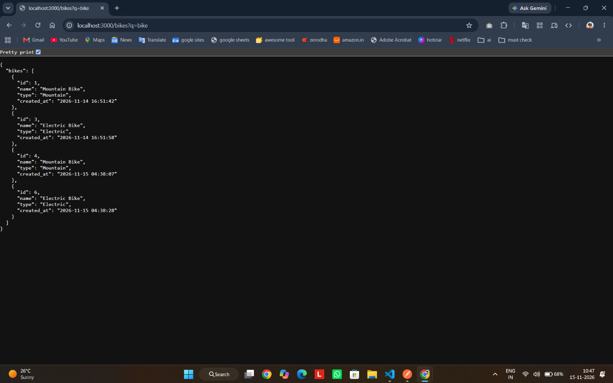
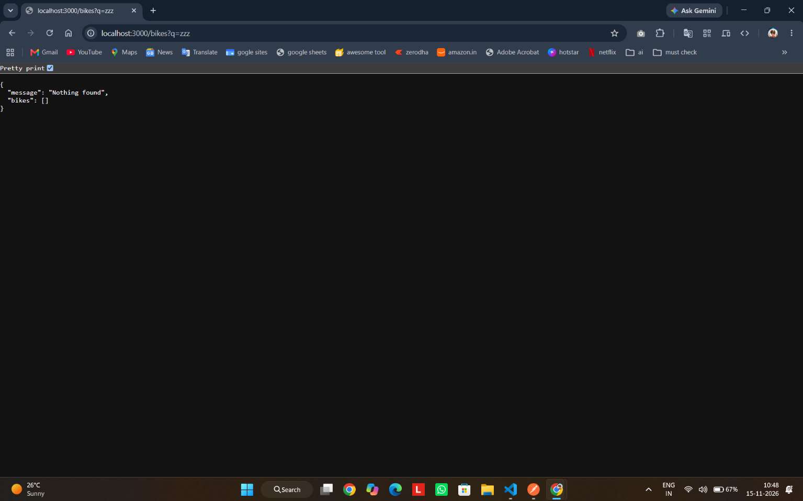

# SpinCycle Bikes

**Campus Bike Share — Backend API**

A RESTful backend for managing campus bike rentals, riders, and bicycles. Built with Node.js, Express, and SQLite as part of **Backend Development Fundamentals — Group Assignment**.


**Assignment ID:** `ST-AIDE2A-G03`
**Live Deployment Link** https://spincycle-bikes-group-assignment.onrender.com/

## Overview

SpinCycle Bikes provides APIs to manage a campus bicycle-sharing system. It replaces manual rental record-keeping with a backend application that stores rider, bike, and rental information in a relational SQLite database.

### Features

- **Bike Management:** Create, view, update, and delete bikes.
- **Rider Management:** Register riders and retrieve rider information.
- **Rental Management:** Create rentals, view rental records, and record bike returns.
- **Smart Search:** Search bikes by name or type using partial, case-insensitive keyword matching.
- **Input Validation:** Validate incoming data and handle invalid requests.
- **Relational Database:** Use primary keys, foreign keys, and SQL JOINs to connect records.
- **Rental Protection:** Prevent deletion of bikes referenced by rental records.

## Smart Search

The assignment-specific requirement is implemented through the `q` query parameter.

```http
GET /bikes?q=road
```

| Search | Expected result |
|---|---|
| `/bikes?q=bike` | Matching bikes |
| `/bikes?q=BIKE` | Same case-insensitive matching |
| `/bikes?q=zzz` | No matching records |
| `/bikes` | All bikes |

When no results are found:

```json
{
  "message": "Nothing found",
  "bikes": []
}
```

## Tech Stack

| Technology | Usage |
|---|---|
| Node.js | JavaScript runtime |
| Express.js | REST API framework |
| SQLite | Database |
| SQL | Queries and relationships |
| Postman | API testing |
| Git & GitHub | Version control |

## Getting Started

### Prerequisites

- Node.js and npm
- Git
- Postman (for API testing)

### Installation

```bash
git clone https://github.com/pratikj0963-droid/SpinCycle_Bikes-Group-assignment-.git
cd SpinCycle_Bikes-Group-assignment-
npm install
```

### Run the server

```bash
npm start
```

For development:

```bash
npm run dev
```

The API runs at:

```text
http://localhost:3000
```

The SQLite database and required tables are initialized automatically when the server starts.

## API Reference

All endpoints use the base URL `http://localhost:3000`.

| Method | Endpoint | Description |
|---|---|---|
| GET | `/` | API welcome message |
| GET | `/bikes` | Get all bikes |
| GET | `/bikes?q=word` | Search bikes |
| GET | `/bikes/:id` | Get a bike by ID |
| POST | `/bikes` | Add a bike |
| PUT | `/bikes/:id` | Update a bike |
| DELETE | `/bikes/:id` | Delete a bike |
| GET | `/riders` | Get all riders |
| GET | `/riders/:id` | Get a rider by ID |
| POST | `/riders` | Register a rider |
| GET | `/rentals` | Get all rentals |
| GET | `/rentals/:id` | Get a rental by ID |
| POST | `/rentals` | Create a rental |
| GET | `/rentals/details` | Get joined rental details |
| POST | `/rentals/:id/return` | Record a bike return |

### Example request bodies

**Add a bike**

```json
{
  "name": "Roadster 100",
  "type": "Road"
}
```

**Register a rider**

```json
{
  "name": "Asha Rao",
  "email": "asha@example.com"
}
```

**Create a rental**

```json
{
  "rider_id": 1,
  "bike_id": 1
}
```

## Database Structure

The application uses three related tables:

- **riders** — stores rider information.
- **bikes** — stores bicycle information.
- **rentals** — connects riders and bikes through foreign keys and stores rental and return dates.

A rental details endpoint uses SQL JOINs to retrieve related rider and bike information.

## Project Structure

```text
SpinCycle_Bikes/
├── src/
│   ├── routes/
│   │   ├── bikes.js
│   │   ├── riders.js
│   │   └── rentals.js
│   ├── utils/
│   │   └── validation.js
│   └── database.js
├── postman/
│   └── SpinCycle_Bikes.postman_collection.json
├── screenshots/
├── .gitignore
├── package.json
├── package-lock.json
├── server.js
└── README.md
```

## API Testing

The Postman collection is available in the `postman/` directory.

1. Start the server.
2. Import the collection into Postman.
3. Send requests to the required endpoints.
4. Verify response data and HTTP status codes.

## Screenshots

The following screenshots demonstrate the application and API requests.

| Server | All Bikes | Smart Search |
|---|---|---|
|  |  |  |

| Empty Search | All Rentals | Rental Details |
|---|---|---|
|  |  |  |

| Add Bike | Update Bike | Delete Bike |
|---|---|---|
|  |  |  |

## Team

| Member | Responsibility |
|---|---|
| Pratik Jadhav | Server setup and route configuration |
| Eekshitha Naidu | SQLite database and relationships |
| Jahnavi Reddy | REST API endpoints |
| Rishitha Reddy | Input validation and Smart Search |
| Hemanth Kumar | Postman testing and documentation |

## Assignment Details

- **Assignment:** Backend Development Fundamentals — Group 3
- **Assignment ID:** ST-AIDE2A-G03
- **Theme:** Campus Bike Share
- **Project:** SpinCycle Bikes

---

**Built as a collaborative backend development project.**
